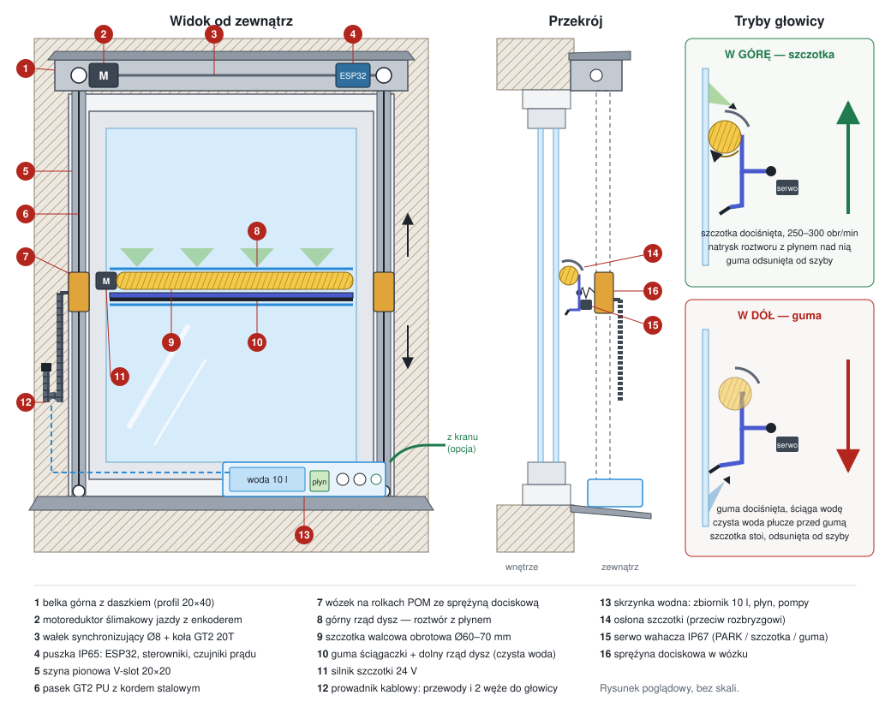
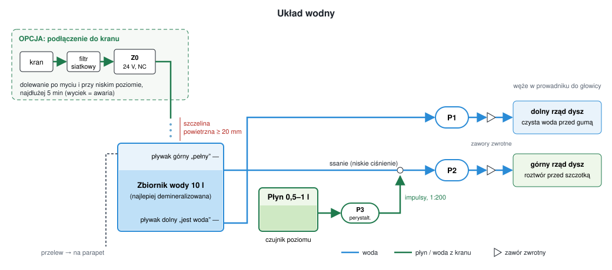

# Myjka okienna MO-1

### Projekt automatycznej myjki ze szczotką obrotową do zewnętrznej strony szyby, zamontowanej na stałe przy oknie



---

## 1. Cel i założenia

Urządzenie ma samo myć **zewnętrzną** stronę jednej szyby (jednego skrzydła) okna, bez wychylania się przez okno i bez zdejmowania czegokolwiek. Montuje się je raz, a potem uruchamia przyciskiem w telefonie, z Home Assistanta albo według harmonogramu.

| Wymaganie | Wartość docelowa |
|---|---|
| Wielkość szyby | szerokość 500–1400 mm, wysokość 600–1800 mm |
| Typ okna | PCV / drewno / alu, skrzydło otwierane **do wewnątrz** (rozwierne, rozwierno-uchylne) |
| Mycie | **szczotka obrotowa** z roztworem płynu, potem ściąganie gumą z płukaniem czystą wodą |
| Woda | **zbiornik 10 l** albo **podłączenie do kranu** (automatyczne dolewanie zbiornika) |
| Płyn myjący | osobny pojemnik 0,5–1 l, dozowanie automatyczne (domyślnie 1:200) |
| Pokrycie powierzchni | ≥ 95 % szyby (bez pasków ok. 10 mm przy uszczelkach) |
| Czas mycia | ≤ 7 min (2 cykle szczotkowanie + ściąganie) |
| Zużycie | ok. 1 l wody i ok. 2–3 ml płynu na mycie |
| Zasilanie | 24 V DC (SELV), zasilacz 100 W wewnątrz mieszkania |
| Szczelność | elektronika IP65, złącza IP67, serwo IP67 |
| Temperatura pracy | +3 … +40 °C (poniżej blokada) |
| Montaż | bez wiercenia w szybie i skrzydle; uchwyty na ościeżnicy lub w ościeżu |
| Okno nadal się otwiera | tak — cała mechanika jest na części nieruchomej |
| Koszt części | ok. 1850 zł, z zestawem do kranu ok. 2000 zł (prototyp) |

## 2. Koncepcja

Rozważone warianty:

| Wariant | Zalety | Wady | Decyzja |
|---|---|---|---|
| Robot magnetyczny (typu Winbot/Hobot) | gotowy produkt | trzeba go przykładać do szyby, przez szybę zespoloną magnes trzyma słabo, ryzyko upadku | ✗ |
| Wycieraczka wahadłowa (jak w aucie) | prosta | myje wycinek koła, narożniki zostają brudne, nie da się dodać szczotki obrotowej | ✗ |
| **Bramka liniowa: głowica ze szczotką jeżdżąca w pionie po dwóch szynach** | myje cały prostokąt, prosta kinematyka, nic nie wisi na skrzydle | trzeba dopasować do wymiaru okna | ✓ |

**Wybrana koncepcja:** po obu stronach szyby, na ościeżnicy, biegną dwie pionowe szyny. Po nich jeździ pozioma **głowica** na całą szerokość szyby. Na głowicy są: **szczotka walcowa obracana silnikiem**, guma ściągaczki i dwa rzędy dysz. U góry jest belka z silnikiem jazdy, wałkiem synchronizującym i elektroniką. Na dole, na parapecie zewnętrznym, stoi skrzynka wodna: zbiornik wody, pojemnik na płyn i pompy. Zbiornik można napełniać ręcznie albo podłączyć do kranu.

Mycie odbywa się jak u profesjonalnego myjącego okna. Najpierw szczotka szoruje szybę roztworem płynu (jazda w górę), potem guma ściąga brud razem z wodą, a dysze tuż przed gumą płuczą szybę czystą wodą (jazda w dół).

## 3. Budowa mechaniczna

### 3.1. Rama i montaż

- **Szyny pionowe:** profil aluminiowy V-slot 20×20 anodowany (2 szt.), długość = wysokość szyby + 150 mm. Mocowane do lica ościeżnicy po bokach skrzydła albo w ościeżu.
- **Belka górna:** profil 20×40, długość = szerokość ramy. Mieści wałek, łożyska i puszkę elektroniki. Przykryta daszkiem z blachy alu 0,8 mm (osłona przed deszczem i UV).
- **Mocowanie:**
  - *bez wiercenia:* stalowe uchwyty typu „Z” takie jak do moskitier ramkowych — zaczepiają o ościeżnicę, a zamknięte skrzydło je dociska. Wystarcza tylko na parterze, bo urządzenie ze szczotką waży ok. 6 kg.
  - *na stałe (zalecane):* 4 kątowniki nierdzewne przykręcone wkrętami A2 do ościeżnicy (w PCV — w strefę wzmocnienia stalowego). W ociepleniu (styropian/wełna) **nie kotwić** — elewacja nie utrzyma obciążenia.
  - zawsze dodatkowo **linka asekuracyjna** ze stali nierdzewnej Ø2 mm od belki górnej do kotwy w ościeżnicy. Urządzenie wisi nad chodnikiem.
- **Kontrola geometrii:** szyny muszą być równoległe — przekątne ramy równe z dokładnością ±2 mm, inaczej głowica się zaklinuje.

### 3.2. Napęd jazdy

- **Jeden silnik**, dwa paski. Motoreduktor ślimakowy 24 V z enkoderem (30–40 obr/min, ≥ 0,5 Nm) w lewym końcu belki górnej napędza wałek nierdzewny Ø8 mm na całą szerokość. Na obu końcach wałka są koła GT2 20T, a od nich biegną w dół paski do rolek napinających na dole szyn.
- **Wałek synchronizujący** gwarantuje, że oba końce głowicy jadą idealnie równo. Przy dwóch osobnych silnikach głowica przekoszałaby się i zakleszczała.
- **Przekładnia ślimakowa jest samohamowna:** po zaniku zasilania głowica nie zjedzie sama w dół. Nie potrzeba hamulca ani przeciwwagi.
- **Paski:** GT2 6 mm z poliuretanu z kordem stalowym (zwykłe gumowe z włóknem szklanym parcieją od UV i wilgoci).
- **Wózki:** po dwa na każdą stronę, na rolkach z POM (mini V-wheel); łożyska nierdzewne lub uszczelnione 2RS.
- **Krańcówki:** czujniki Halla A3144 w drukowanych obudowach zalanych żywicą, magnesy neodymowe na wózku. Krańcówki są dwie (góra i dół); dodatkowo oprogramowanie pilnuje miękkich limitów z enkodera.

### 3.3. Głowica ze szczotką obrotową

Głowica to belka aluminiowa z **wahaczem** obracającym się na osi poziomej, równoległej do szyby. Na wahaczu, od góry:

1. **Górny rząd dysz (roztwór)** — 3–4 dysze płaskostrumieniowe skierowane na szybę nad szczotką. Przy jeździe w górę szyba jest zwilżana roztworem tuż przed szczotką.
2. **Szczotka walcowa** Ø60–70 mm na całą szerokość szyby:
   - włosie: miękki, rozszczepiony nylon 0,10–0,15 mm (jak w szczotkach do mycia aut i fotowoltaiki) — nie rysuje szkła;
   - obroty: 250–300 obr/min, z łagodnym startem;
   - kierunek obrotu: włosie przy szybie przesuwa się **w dół** — spycha brudną wodę na dół, a siła reakcji pomaga unosić głowicę;
   - napęd: motoreduktor 24 V (15–25 W) na lewym końcu głowicy, poza obrysem szyby; na prawym końcu łożysko 2RS;
   - **osłona** z blachy aluminiowej nad szczotką od strony zewnętrznej ogranicza rozbryzg na elewację i przechodniów;
   - wykonanie: gotowa szczotka walcowa na zamówienie albo, taniej, szczotka paskowa nawinięta spiralnie na rurę aluminiową Ø25 mm.
3. **Guma ściągaczki** — typowa wymienna guma do profesjonalnych ściągaczek, w szynie mocującej.
4. **Dolny rząd dysz (czysta woda)** — skierowany na szybę pod gumą. Przy jeździe w dół płucze szybę i utrzymuje ją mokrą tuż przed gumą, dzięki czemu guma nie „skacze” po suchym szkle, a resztki płynu spływają.

**Przełączanie trybu — serwo wahacza.** Wahacz przestawia wodoodporne serwo IP67 (≥ 25 kg·cm) w jedną z trzech pozycji:

| Pozycja | Kąt | Co dotyka szyby | Kiedy |
|---|---|---|---|
| PARK | 0° | nic (oba elementy ok. 3 mm od szyby) | postój, bazowanie |
| SZCZOTKA | −10° | szczotka | jazda w górę |
| GUMA | +10° | guma | jazda w dół |

Oś wahacza jest dociskana do szyby dwiema długimi sprężynami w wózkach (łącznie ok. 20 N). W pozycji PARK ograniczniki skoku trzymają głowicę 3 mm od szyby. Przy ramieniu `h = 40 mm` przechył o 10° przesuwa element o ok. 7 mm w stronę szyby. Element dotyka szkła i ściska sprężyny, więc nacisk na szybę wyznaczają sprężyny, a nie serwo. W pozycji PARK guma się nie odkształca, a włosie nie wygina się podczas długiego postoju.

> W pierwszej wersji projektu głowica była pasywna (mikrofibra zamiast szczotki, tryb przełączany samym tarciem). Szczotka obrotowa wytwarza własne siły styczne, które rozregulowałyby taki mechanizm, a i tak wymaga zasilania na głowicy. Dlatego tryb przełącza teraz serwo.

**Przewody i węże do głowicy** biegną w **prowadniku kablowym** 10×10 mm (PA6 odporny na UV) wzdłuż lewej szyny. Stały koniec prowadnika jest w połowie wysokości szyny, a pętla zwisa w dół. W prowadniku są:
- przewód PUR 5×0,5 mm²: silnik szczotki (+/−), serwo (6 V, GND, sygnał),
- dwa węże PU 4/6 mm: roztwór i czysta woda.

**Dopasowanie do okna:** głowica jest o ok. 20 mm węższa od widocznej szyby. Ramiona łączące ją z wózkami mają kształt „Z” i omijają ramę skrzydła od zewnątrz. Skok sprężyn (≥ 20 mm) kompensuje to, że szyba leży kilka milimetrów głębiej niż lico skrzydła. Gdy skrzydło jest otwarte, głowica opiera się na ograniczniku skoku i nie wpada do środka (a sterownik i tak blokuje pracę — kontaktron).

### 3.4. Układ wodny: zbiornik albo kran, osobno płyn



**Skrzynka wodna** stoi na parapecie zewnętrznym. W środku są:

- **Zbiornik wody 10 l** z dwoma pływakami (dolny: „jest woda”, górny: „pełny”) i przelewem na parapet.
- **Pojemnik na płyn 0,5–1 l** (koncentrat) z bezdotykowym czujnikiem poziomu przyklejonym do ścianki.
- **P1** — pompa membranowa 24 V: czysta woda do dolnego rzędu dysz (płukanie przed gumą).
- **P2** — pompa membranowa 24 V: roztwór do górnego rzędu dysz (przed szczotką).
- **P3** — pompa perystaltyczna 24 V: podaje płyn z pojemnika do **ssania** pompy P2. Działa impulsowo i utrzymuje zadane stężenie (domyślnie 1:200, czyli 0,5 %). Ssanie jest pod niskim ciśnieniem, więc tania pompa perystaltyczna sobie poradzi. Zatrzymana pompa perystaltyczna zaciska wężyk, więc płyn nie kapie.
- Zawory zwrotne za P1 i P2 (woda nie cofa się z węży, dysze nie kapią).

Czysta woda i roztwór mają **osobne pompy i osobne dysze**, więc płukanie zawsze idzie czystą wodą, bez płynu. Gdy płyn się skończy, urządzenie myje samą wodą i zgłasza ostrzeżenie.

**Dwa sposoby zasilania wodą:**

1. **Sam zbiornik** (`REFILL_FROM_MAINS = false`) — napełniany lejkiem przez otwarte okno. 10 l starcza na ok. 10 myć.
2. **Podłączenie do kranu** (`REFILL_FROM_MAINS = true`) — wąż ogrodowy z kranu (na balkonie, tarasie, parterze) przez filtr siatkowy i zawór elektromagnetyczny **Z0** (24 V, normalnie zamknięty) do wylewki **nad** zbiornikiem. Sterownik dolewa wodę po każdym myciu i gdy poziom spadnie, aż do górnego pływaka. Zbiornik zostaje jako bufor, a pompy działają tak samo jak w wariancie 1.

**Dlaczego kran nie jest połączony bezpośrednio z dyszami:** woda z kranu wpada do zbiornika przez **szczelinę powietrzną** (wylewka ≥ 20 mm nad poziomem przelewu, typ AA wg PN-EN 1717). To najpewniejsza ochrona wodociągu przed cofnięciem wody z płynem myjącym i nie wymaga drogiego zaworu antyskażeniowego. Do tego woda dozowana do zbiornika nie potrzebuje reduktora ciśnienia, a pompa perystaltyczna nie musi pokonywać ciśnienia z sieci.

**Zabezpieczenia dolewania:** zawór Z0 jest normalnie zamknięty (zanik prądu = brak wody). Dolewanie trwające dłużej niż 5 min jest traktowane jako awaria (wyciek albo zakręcony kran). Przelew odprowadza ewentualny nadmiar na parapet. Przerwany przewód górnego pływaka oznacza „pełny”, więc dolewanie się nie włączy.

**Co wlewać:**
- najlepiej **wodę demineralizowaną** (w wariancie ze zbiornikiem) — nie zostawia zacieków z kamienia; przy twardej wodzie z kranu można dodać mały filtr zmiękczający/demineralizujący na wężu;
- do pojemnika na płyn: koncentrat do mycia szyb **bez wosku i bez nabłyszczaczy** (np. płyn do szyb dla profesjonalistów lub kilka procent płynu do naczyń w wodzie). Stężenie ustawia `DOSE_RATIO` w `config.h`.

**Zima:** poniżej +3 °C urządzenie nie myje i nie dolewa wody. Na zimę należy zakręcić kran, opróżnić zbiornik i przepompować pompy do sucha (kilka sekund pracy na pusto nie szkodzi pompom membranowym). Można też zalać zbiornik płynem do spryskiwaczy samochodowych na −20 °C i wyłączyć dolewanie z kranu.

## 4. Elektronika

### 4.1. Schemat blokowy

```
 [zasilacz 24 V / 100 W]──(przewód 2×1 mm² przez przepust okienny)──┐
         (wewnątrz)                                                   │
                                          ┌───────────────────────────┴───┐
                                          │ puszka IP65 (belka górna)     │
                                          │ bezpiecznik 5 A               │
                                          │ INA219 #1 ── DRV8871 ─────────┼──► silnik jazdy + enkoder
                                          │ INA219 #2 ── MOSFET (PWM) ────┼──► silnik szczotki  ┐ prowadnik
                                          │ XL4015 24→6 V ────────────────┼──► serwo wahacza    ┘ kablowy
                                          │ MP1584 24→5 V ── ESP32        │
                                          │   ├─ MOSFET ──────────────────┼──► P1 pompa czystej wody   ┐
                                          │   ├─ MOSFET ──────────────────┼──► P2 pompa roztworu       │ skrzynka
                                          │   ├─ MOSFET ──────────────────┼──► P3 pompa płynu          │ wodna
                                          │   └─ MOSFET ──────────────────┼──► Z0 zawór dolewania      ┘
                                          └───┬───────────────────────────┘
  krańcówki góra/dół (Hall), enkoder ─────────┤
  kontaktron skrzydła ────────────────────────┤
  pływak dolny i górny, czujnik płynu ────────┤
  czujnik deszczu, DS18B20 ───────────────────┘
```

Przewód zasilający 24 V przechodzi przez **płaski przepust okienny** (taśma przeciskana pod uszczelką) albo przez otwór wywiercony w ościeżnicy tak jak przy roletach zewnętrznych. Napięcie 230 V nigdy nie wychodzi na zewnątrz. Wszystkie wejścia z czujników zewnętrznych mają rezystor szeregowy 1 kΩ i diodę TVS (ochrona przed przepięciami z długich przewodów). Silniki, pompy i zawór mają diody zwrotne.

**Wariant solarny (opcja):** mycie zużywa ok. 2 Wh. Panel 20 W na daszku belki, akumulator LiFePO4 12 V 12 Ah i ESP32 w uśpieniu (deep sleep) pozwalają zrezygnować z kabla przez okno. Wymaga wersji silników i pomp na 12 V.

### 4.2. Przyporządkowanie pinów ESP32

| GPIO | Funkcja | Uwagi |
|---|---|---|
| 25 | DRV8871 IN1 (PWM) | 20 kHz, jazda w górę |
| 26 | DRV8871 IN2 (PWM) | jazda w dół |
| 27 | MOSFET silnika szczotki (PWM) | łagodny start |
| 18 | sygnał serwa wahacza | 50 Hz |
| 34 / 35 | enkoder A / B | tylko wejścia — zewnętrzne pull-upy 10 kΩ do 3,3 V |
| 32 / 33 | krańcówka górna / dolna | pull-up wewnętrzny, LOW = magnes |
| 16 | MOSFET pompy P1 (czysta woda) | |
| 17 | MOSFET pompy P2 (roztwór) | |
| 15 | MOSFET pompy P3 (płyn) | przy starcie ESP32 pin daje krótkie impulsy — dla pompy dozującej bez znaczenia |
| 23 | MOSFET zaworu Z0 (dolewanie z kranu) | |
| 14 | kontaktron skrzydła | LOW = okno zamknięte; przerwany przewód = „otwarte” |
| 13 | pływak dolny | LOW = jest woda; przerwany przewód = „brak wody” |
| 36 | pływak górny | LOW = poniżej górnego poziomu; przerwany przewód = „pełny”; zewn. pull-up |
| 39 | czujnik płynu | LOW = jest płyn; zewn. pull-up |
| 4 | czujnik deszczu (wyjście cyfrowe) | LOW = mokro |
| 19 | DS18B20 (1-Wire) | pull-up 4,7 kΩ |
| 21 / 22 | I²C SDA / SCL | INA219 0x40 (jazda), INA219 0x41 (szczotka, zworka A0) |
| 2 | LED stanu | |

Czujniki są podłączone tak, żeby **przerwany przewód oznaczał stan bezpieczny**: okno „otwarte” i „brak wody” → urządzenie nie ruszy; zbiornik „pełny” → zawór się nie otworzy.

## 5. Oprogramowanie

Kod sterownika: [`firmware/myjka/myjka.ino`](firmware/myjka/myjka.ino), konfiguracja: [`firmware/myjka/config.h`](firmware/myjka/config.h). Wymaga Arduino-ESP32 3.x oraz bibliotek *OneWire*, *DallasTemperature* i *Adafruit INA219*.

### 5.1. Cykl mycia (pozycja spoczynkowa: na dole, wahacz w PARK)

1. **Kontrola wstępna:** okno zamknięte, temperatura ≥ 3 °C, brak deszczu, jest woda, działają oba czujniki prądu. Brak płynu nie blokuje mycia (ostrzeżenie: „myję samą wodą”).
2. **Bazowanie:** wahacz w PARK, zjazd do dolnej krańcówki, wyzerowanie enkodera.
3. Dla każdego cyklu (domyślnie 2):
   1. wahacz → **SZCZOTKA**,
   2. **jazda w górę** (80 %): szczotka się kręci, pompa P2 podaje roztwór, a P3 dozuje do niego płyn,
   3. 10 s na działanie płynu,
   4. wahacz → **GUMA**,
   5. **jazda w dół** (60 %, w ostatnim cyklu 50 %): guma ściąga, a pompa P1 płucze szybę czystą wodą tuż przed gumą.
4. Wahacz → PARK. W wariancie z kranem sterownik dolewa zbiornik.

Przy pierwszej jeździe w górę sterownik mierzy skok (liczbę impulsów enkodera między krańcówkami) i potem używa go jako miękkiego limitu.

### 5.2. Zabezpieczenia

| Zdarzenie | Reakcja |
|---|---|
| Otwarcie okna w trakcie pracy | natychmiastowe zatrzymanie wszystkiego (**awaria**) |
| Prąd silnika jazdy > limitu (zakleszczenie, lód, przeszkoda) | natychmiastowe zatrzymanie (**awaria**) |
| Prąd szczotki > limitu (zablokowana, nawinięty liść, lód) | natychmiastowe zatrzymanie (**awaria**) |
| Enkoder stoi mimo zasilania silnika > 400 ms | zatrzymanie (**awaria**) |
| Przekroczenie skoku o > 3 % (krańcówka nie zadziałała) | zatrzymanie (**awaria**) |
| Ruch trwa dłużej niż 150 s | zatrzymanie (**awaria**) |
| Dolewanie z kranu trwa > 5 min | zamknięcie zaworu (**awaria**) — wyciek lub zakręcony kran |
| Deszcz lub brak wody w trakcie mycia | łagodne przerwanie: zjazd gumą w dół, wahacz w PARK (**ostrzeżenie**) |
| Brak płynu | mycie samą wodą (**ostrzeżenie**) |
| Zawieszenie programu | watchdog sprzętowy resetuje ESP32 → wszystkie wyjścia wyłączone |

W wariancie z kranem chwilowy spadek poziomu w trakcie mycia nie przerywa pracy przez 30 s, bo w tym czasie trwa dolewanie. Po awarii urządzenie wymaga ręcznego skasowania (`/reset`), żeby nie ponawiało ruchu na ślepo, np. przy przymarzniętej głowicy.

Kod sprawdziłem w symulacji na komputerze (wirtualna głowica i czujniki): normalny cykl, deszcz w trakcie, otwarcie okna i brak wody dają opisane wyżej reakcje. Na prawdziwym ESP32 jeszcze go nie kompilowałem.

### 5.3. Sterowanie

- Strona WWW pod `http://myjka.local/` (przyciski Myj / STOP / Reset).
- API: `/start?cycles=2`, `/stop`, `/reset`, `/status` (JSON: stan, krok, błędy, prądy, poziomy wody i płynu, dolewanie).
- Port szeregowy (115200): `s` start, `x` stop, `r` reset, `?` status.

### 5.4. Integracja z Home Assistant

```yaml
rest_command:
  myjka_start:
    url: "http://myjka.local/start?cycles=2"
  myjka_stop:
    url: "http://myjka.local/stop"

sensor:
  - platform: rest
    name: Myjka okienna
    resource: http://myjka.local/status
    value_template: "{{ value_json.mode }}"
    json_attributes: [error, warning, temp_c, water_ok, fluid_ok, refilling, raining, step]
    scan_interval: 30

automation:
  - alias: "Mycie okna w sobotę rano"
    trigger:
      - platform: time
        at: "09:30:00"
    condition:
      - condition: time
        weekday: [sat]
      - condition: numeric_state
        entity_id: weather.dom
        attribute: temperature
        above: 5
      - condition: state
        entity_id: weather.dom
        state: ["sunny", "partlycloudy", "cloudy"]
    action:
      - service: rest_command.myjka_start

  - alias: "Myjka — kończy się płyn"
    trigger:
      - platform: template
        value_template: "{{ state_attr('sensor.myjka_okienna', 'fluid_ok') == false }}"
    action:
      - service: notify.notify
        data:
          message: "Myjka okienna: dolej płynu do pojemnika."
```

Najlepiej myć rano albo przy zachmurzeniu. W pełnym słońcu woda wysycha przed przejściem gumy i zostają smugi.

## 6. Obliczenia

Przykład: szyba 1000 × 1300 mm.

**Siły jazdy (najgorszy przypadek — jazda w górę):**

| Składnik | Wartość |
|---|---|
| Ciężar głowicy ze szczotką, silnikiem, serwem i wózkami (≈ 1,8 kg) | 17,7 N |
| Opór szczotki: 0,5 × 20 N (przy złym kierunku obrotów; przy właściwym szczotka pomaga) | 10,0 N |
| Opory wózków, pasków i prowadnika | 3,0 N |
| **Razem** | **≈ 31 N** |
| Z zapasem ×2 | 62 N |

**Moment na kole GT2 20T** (promień podziałowy 6,37 mm): 62 N × 0,00637 m ≈ **0,40 Nm** → motoreduktor ≥ 0,5 Nm.

Jazda w dół: tarcie gumy 0,8 × 20 N = 16 N jest mniej więcej równe ciężarowi głowicy (17,7 N). Głowica prawie się równoważy, więc silnik ma małe obciążenie, a samohamowna przekładnia nie pozwala jej przyspieszyć.

**Szczotka:** moment oporu ≈ 0,5 × 20 N × 0,032 m ≈ 0,32 Nm. Przy 280 obr/min (29 rad/s) daje to ≈ 9 W mocy na wale → silnik 15–25 W, ≥ 0,4 Nm.

**Serwo:** moment potrzebny do docisku elementu = 20 N × 0,04 m = 0,8 Nm ≈ 8 kg·cm. Serwo 25 kg·cm daje zapas ×3.

**Prędkość i czas:** 40 obr/min × 40 mm/obr ≈ 27 mm/s bez obciążenia. Szczotkowanie (80 %) ≈ 19 mm/s → 68 s na przejazd, ściąganie (60 %) ≈ 14 mm/s → 93 s. Pełne mycie (bazowanie + 2 cykle): **≈ 6 min**.

**Woda i płyn:**
- roztwór: 0,2 l/min × 68 s × 2 przejazdy ≈ 0,45 l,
- płukanie: 0,15 l/min × ok. 200 s ≈ 0,5 l,
- razem **ok. 1 l na mycie** → zbiornik 10 l starcza na ok. 10 myć (bez kranu),
- płyn 0,5 % × 0,45 l ≈ **2,3 ml na mycie** → butelka 0,5 l starcza na ok. 200 myć.

**Dozowanie:** pompa perystaltyczna 0,06 l/min, co 10 s włączana na 10 000 × 0,005 × 0,2 / 0,06 ≈ 170 ms. Wąż do głowicy (ok. 40 ml) wyrównuje impulsy. Wydatki pomp i dysz trzeba zmierzyć menzurką i wpisać do `config.h`.

**Energia:** jazda ≈ 10 W × 6 min + szczotka ≈ 15 W × 2,5 min + pompy ≈ 2 × 8 W × 3,5 min ≈ **2 Wh na mycie**. ESP32 w czuwaniu z Wi-Fi zużywa ok. 0,5 W (12 Wh/dobę) i to on dominuje bilans.

**Zasilacz:** jazda 0,5 A + szczotka 1 A + pompy 0,8 A + serwo ok. 0,3 A (po stronie 24 V) + zawór 0,2 A ≈ 2,8 A szczytowo → **24 V 100 W** (4,2 A).

## 7. Bezpieczeństwo i warunki pracy

- **Spadające przedmioty** — największe ryzyko. Linka asekuracyjna, śruby nierdzewne z zabezpieczeniem (nakrętki samokontrujące lub klej do gwintów), przegląd mocowań co pół roku.
- **Rozbryzg:** osłona szczotki i umiarkowane obroty (≤ 300 obr/min) ograniczają chlapanie. Nad chodnikiem lepiej myć w godzinach małego ruchu.
- **Elektryka:** na zewnątrz wyłącznie 24 V DC (SELV), zasilacz z atestem wewnątrz, bezpiecznik 5 A w puszce, wszystkie przepusty na dławikach.
- **Woda z kranu:** szczelina powietrzna nad zbiornikiem chroni wodociąg przed cofnięciem się wody z płynem, a zawór normalnie zamknięty i limit czasu dolewania chronią przed zalaniem.
- **Mróz:** blokada poniżej +3 °C (mycie i dolewanie). Na zimę zakręcić kran i opróżnić układ (rozdz. 3.4). Przymarznięta guma lub szczotka zostanie wykryta jako przeciążenie i silnik stanie, zanim coś urwie.
- **Wiatr:** głowica jest dociśnięta do szyby, a belka i szyny są przykręcone do ościeżnicy.
- **Owady i pająki:** szczotkowe uszczelki na wlotach szyn, przegląd wiosną.
- **Formalności:** w bloku montaż na elewacji może wymagać zgody wspólnoty lub spółdzielni. Warto to sprawdzić przed montażem, zwłaszcza na budynku po termomodernizacji.

## 8. Lista materiałów (BOM)

Ceny orientacyjne, detaliczne, 2026 r.

| # | Element | Ilość | Cena [zł] |
|---|---|---|---|
| | **Rama i napęd jazdy** | | |
| 1 | Profil V-slot 20×20 anodowany, 1,6 m | 2 | 80 |
| 2 | Profil 20×40 na belkę górną, 1,2 m | 1 | 45 |
| 3 | Wózki z rolkami POM (mini V-wheel) | 4 | 60 |
| 4 | Pasek GT2 6 mm PU z kordem stalowym | 4 m | 50 |
| 5 | Koło GT2 20T, otwór 8 mm | 2 | 20 |
| 6 | Rolka napinająca gładka do GT2 | 2 | 20 |
| 7 | Wałek nierdzewny Ø8 + 2 łożyska KFL08 + sprzęgło | kpl. | 70 |
| 8 | Motoreduktor ślimakowy 24 V z enkoderem, 30–40 obr/min, ≥ 0,5 Nm | 1 | 100 |
| | **Głowica** | | |
| 9 | Belka głowicy — ceownik aluminiowy, 1 m | 1 | 25 |
| 10 | Części drukowane z **ASA** (wahacz, ramiona Z, obudowy, zaślepki) — PLA nie nadaje się na zewnątrz | kpl. | 80 |
| 11 | Sprężyny naciskowe długie, ≈ 0,25 N/mm | 4 | 15 |
| 12 | Guma ściągaczki 1 m + szyna mocująca | 1 | 40 |
| 13 | Szczotka walcowa Ø60–70 mm, miękki rozszczepiony nylon (na zamówienie lub szczotka paskowa na rurze Ø25) | 1 | 150 |
| 14 | Silnik szczotki 24 V z przekładnią, 250–300 obr/min, ≥ 0,4 Nm + sprzęgło | 1 | 80 |
| 15 | Łożyska 2RS, osłona szczotki z blachy alu | kpl. | 40 |
| 16 | Serwo wodoodporne IP67, ≥ 25 kg·cm | 1 | 120 |
| 17 | Prowadnik kablowy 10×10 mm 1,5 m, przewód PUR 5×0,5 mm² 3 m, wąż PU 4/6 mm 2 × 3 m | kpl. | 90 |
| 18 | Dysze płaskostrumieniowe (2 rzędy po 3–4 szt.), 2 zawory zwrotne, złączki | kpl. | 60 |
| | **Skrzynka wodna** | | |
| 19 | Pompy membranowe 24 V, samozasysające (P1, P2) | 2 | 100 |
| 20 | Pompa perystaltyczna 24 V (P3) | 1 | 45 |
| 21 | Kanister 10 l + pływak dolny + przelew | 1 | 40 |
| 22 | Pojemnik na płyn 0,5–1 l + bezdotykowy czujnik poziomu (np. XKC-Y25) | 1 | 35 |
| | **Elektronika** | | |
| 23 | ESP32 DevKit (WROOM-32E) | 1 | 30 |
| 24 | Moduł DRV8871 | 1 | 20 |
| 25 | Moduł INA219 | 2 | 30 |
| 26 | Klucze MOSFET logic-level z diodami (5 kanałów) | kpl. | 30 |
| 27 | Przetwornice 24→5 V (MP1584) i 24→6 V 5 A (XL4015, do serwa) | 2 | 25 |
| 28 | Czujniki: 2× Hall A3144 + magnesy, DS18B20 wodoodporny, kontaktron, czujnik deszczu | kpl. | 50 |
| 29 | Puszki IP65, dławiki, złącza wodoodporne M12 | kpl. | 90 |
| 30 | Zasilacz 24 V 100 W (np. Mean Well) | 1 | 120 |
| 31 | Przewód 2×1 mm², płaski przepust okienny, bezpiecznik 5 A | kpl. | 45 |
| 32 | Uchwyty montażowe nierdzewne, śruby A2, linka asekuracyjna | kpl. | 50 |
| | **Razem** | | **≈ 1855** |
| | **Opcja: podłączenie do kranu** | | |
| 33 | Zawór elektromagnetyczny 24 V DC, NC, mosiężny 1/2" (Z0) | 1 | 60 |
| 34 | Pływak górny | 1 | 15 |
| 35 | Wąż ogrodowy, szybkozłączki, filtr siatkowy, wylewka | kpl. | 60 |
| | **Razem z opcją** | | **≈ 1990** |

Materiały eksploatacyjne: guma ściągaczki (wymiana co ok. 12 mies.), płyn do szyb, szczotka (kontrola co pół roku, wymiana gdy włosie się zbije lub wykruszy).

## 9. Montaż i uruchomienie

1. **Pomiar okna:** widoczna szyba (szer. × wys.), szerokość lica ościeżnicy, głębokość osadzenia szyby względem lica skrzydła, odległość do kranu (jeśli podłączasz).
2. **Docięcie:** szyny = wys. szyby + 150 mm; belka górna = szer. ramy; wałek = szer. ramy; belka głowicy, szczotka i guma = szer. szyby − 20 mm.
3. **Montaż na stole:** złożenie ramy, naciągnięcie pasków (oba z identycznym naciągiem), sprawdzenie przekątnych, montaż głowicy i prowadnika kablowego.
4. **Montaż na oknie:** uchwyty, rama, linka asekuracyjna, skrzynka wodna, węże, ewentualnie wąż z kranu.
5. **Ustawienie krańcówek:** dolna tak, żeby guma zatrzymywała się ok. 5 mm nad dolną uszczelką; górna tak, żeby szczotka dochodziła do górnej uszczelki.
6. **Ustawienie serwa:** w `config.h` dobrać `SERVO_US_PARK` (oba elementy ok. 3 mm od szyby), `SERVO_US_BRUSH` (włosie ugięte ok. 3–4 mm), `SERVO_US_SQUEEGEE` (guma lekko wygięta, jak przy ręcznej ściągaczce).
7. **Elektronika:** wgranie programu, ustawienie Wi-Fi i źródła wody w `config.h`, sprawdzenie każdego czujnika w `/status` (otwórz/zamknij okno, wyjmij pływaki, opróżnij pojemnik płynu, zrosz czujnik deszczu).
8. **Kalibracja wody:** zmierzyć menzurką wydatek dysz roztworu i płukania oraz pompy perystaltycznej (np. przez 60 s), wpisać `FLOW_SOLUTION_LPM`, `FLOW_DOSE_LPM`.
9. **Próba na sucho:** bez wody, prędkość 30 % — kontrola prądów (`current_ma`, `brush_ma`) i płynności ruchu; ustawić `CURRENT_LIMIT_MA` i `BRUSH_CURRENT_LIMIT_MA` ok. 1,5–2× powyżej normalnych wartości.
10. **Pierwsze mycie** pod nadzorem.

## 10. Plan prototypowania i ryzyka

Pełny kosztorys (stanowisko testowe, prototyp, mała seria), harmonogram z kryteriami odbioru, lista wykonawców oraz przegląd konkurencji i patentów: [kosztorys-i-prototyp.md](kosztorys-i-prototyp.md).

**Etap 1 — stanowisko testowe (przed zakupem całości):** stara szyba lub szkło ok. 60 × 60 cm w drewnianej ramce, krótki odcinek głowicy (30 cm) ze szczotką i gumą, waga hakowa.

- dobrać docisk szczotki i gumy oraz obroty szczotki (efekt kontra rozbryzg),
- sprawdzić, czy szczotka nie zostawia rys po kontakcie z piaskiem (test z celowo zapiaszczoną szybą),
- dobrać stężenie płynu i ilość wody dające szybę bez smug.

**Etap 2 — pełny prototyp na jednym oknie,** testy przez 2–3 tygodnie, również w deszczu (szczelność puszek i serwa), w obu wariantach zasilania wodą.

**Etap 3 — poprawki:** wersja dla okien ze słupkiem (dwie głowice na wspólnym wałku albo dwa urządzenia), ewentualnie wariant solarny.

| Ryzyko | Prawdopodobieństwo | Środek zaradczy |
|---|---|---|
| Rysy od piasku zebranego przez szczotkę | niskie–średnie | miękkie rozszczepione włosie, obfite zwilżenie przed szczotką, płukanie szczotki po myciu, kontrola co pół roku |
| Rozbryzg brudnej wody | średnie | osłona szczotki, umiarkowane obroty |
| Smugi na szybie | średnie | woda demineralizowana, płyn bez nabłyszczaczy, płukanie przed gumą, mycie bez słońca |
| Zakleszczenie na krzywych szynach | średnie | wałek synchronizujący, kontrola przekątnych, luz na wózkach |
| Zawilgocenie serwa / silnika szczotki | średnie | podzespoły IP67, osłony, przewody od dołu w pętli okapowej |
| Wyciek przy podłączeniu do kranu | niskie | zawór NC, limit czasu dolewania, przelew, zakręcanie kranu na zimę |
| Starzenie gumy i tworzyw od UV | wysokie | ASA zamiast PLA, wymiana gumy co rok, daszek |
| Zamarznięcie | wysokie zimą | blokada temperaturowa, opróżnienie na zimę, wykrywanie przeciążenia |
| Mocne zabrudzenia (ptasie odchody) | średnie | dłuższe działanie płynu (`SOAK_MS`), 3 cykle |

## 11. Ograniczenia

- Jedno urządzenie myje **jedną szybę**. Okno dwuskrzydłowe ze słupkiem wymaga dwóch głowic.
- Paski ok. 10 mm przy uszczelkach i w narożnikach zostają nieumyte — tak samo przy ręcznym myciu ściągaczką.
- Podłączenie do kranu ma sens tam, gdzie kran jest na zewnątrz lub blisko (balkon, taras, parter). Na wyższych piętrach bez balkonu zostaje zbiornik.
- Nie nadaje się do okien otwieranych na zewnątrz, przesuwnych (HST) i dachowych bez przeróbek.
- Zewnętrzne rolety lub żaluzje w tej samej płaszczyźnie kolidują z belką górną — trzeba wtedy zintegrować belkę z kasetą rolety.
